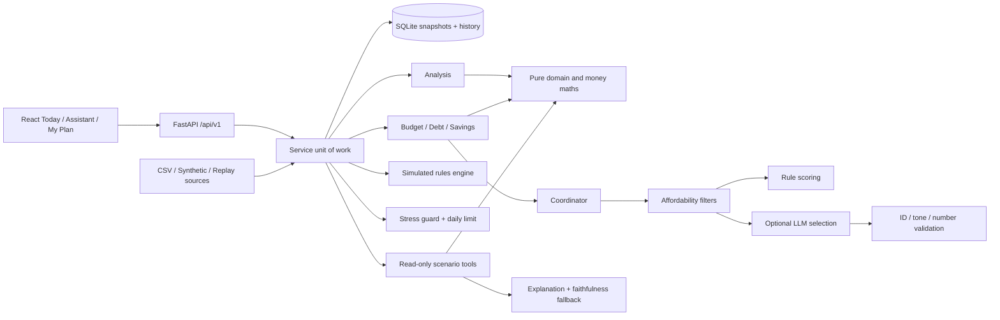
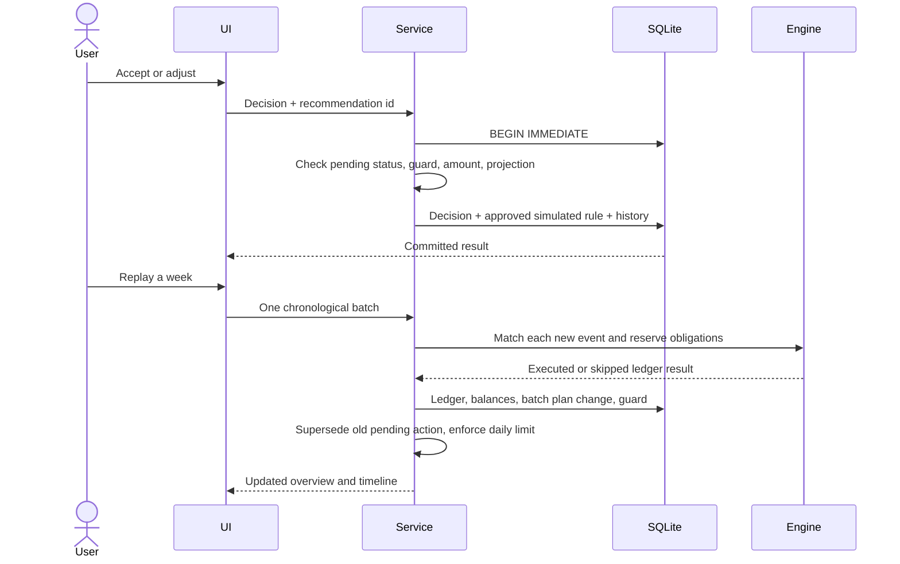

# Architecture

## Persistence model

`Record.key` names profile, transaction collection, current/archived recommendations, daily issuance marker, cooldown map, guard expiry, rules, ledger, lesson/progress, import summary, and synthetic clock. `HistoryEvent` has a monotonic primary key, UTC timestamp, event type, and immutable JSON payload. All service mutations occur in one serialized SQLite transaction; no history update endpoint exists.

## UI wireframe

Desktop: fixed left navigation; top demo/persona bar; two-column Today layout. Main column contains the primary cash figure and one recommendation. Side column contains safety-net progress and the daily lesson. My Plan contains editable profile/obligations, recurring confirmations, rules, and a filterable history. Assistant displays grounded facts and named tools below replies. Narrow viewports use a single column and bottom navigation. Modal dialogs trap keyboard focus and support Escape. Light/dark themes use teal, neutrals, and amber attention messages.
